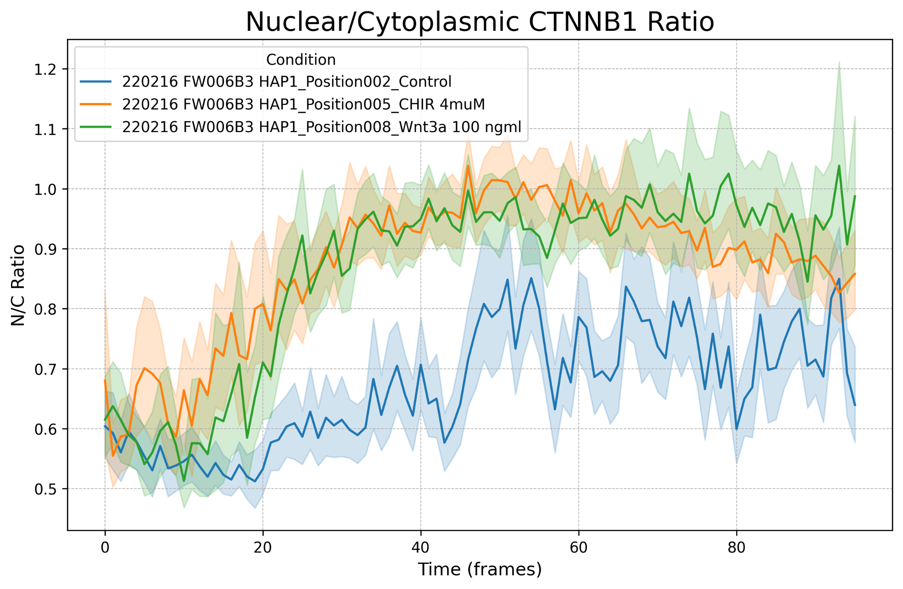
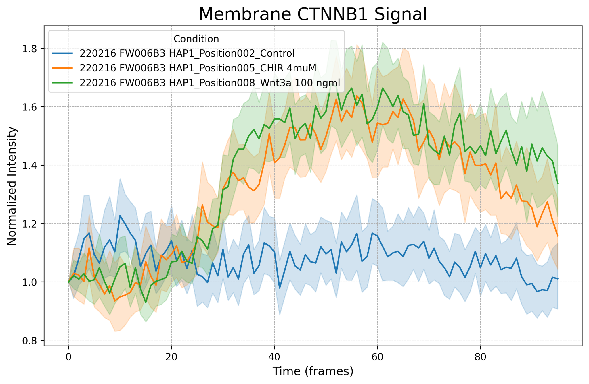

# Drug-Response Imaging Pipeline: Cell Segmentation and Tracking

An image-analysis pipeline for time-lapse fluorescence microscopy. It quantifies how **β-catenin (CTNNB1)** moves between the nucleus, cytoplasm and membrane of HAP1 cells after Wnt-pathway stimulation, and tracks single cells over time.

Built as a group project for the *Image Processing and Quantitative Data Analysis* course (Vrije Universiteit Amsterdam, 2025).


## Question

Does CTNNB1 localisation change significantly under Wnt-pathway activation? Three conditions were imaged over 96 time frames, with two channels each (nuclear marker and CTNNB1):

| Condition | Treatment | Mechanism |
|---|---|---|
| Control | none | baseline |
| Wnt3a | 100 ng/mL | ligand that activates the Wnt pathway |
| CHIR-99021 | 4 µM | GSK3β inhibitor that blocks CTNNB1 degradation |

## Pipeline

1. **Segmentation.** Nuclei and whole cells are segmented with **Cellpose-SAM** (nucleus diameter 90 px, cell diameter 150 px). These diameters were chosen by comparing them against the pretrained `nuclei`/`cyto2` models and against FIJI measurements.
2. **Post-processing.** Cells touching the image border are removed. Each nucleus is assigned to its parent cell by soft overlap (≥ 50 % of nuclear pixels inside the cell). Unmatched nuclei and cells without a nucleus are discarded as segmentation artefacts.
3. **Compartment masks.** Each cell is eroded by 5 px. The membrane mask is the original cell minus the eroded cell, and the cytoplasm mask is the eroded cell minus its nucleus.
4. **Quantification.** Mean CTNNB1 intensity is measured per cell in the nucleus, cytoplasm and membrane (`skimage.measure.regionprops`), giving nuclear-to-cytoplasmic (N/C) ratios and baseline-normalised membrane signal for every time point.
5. **Statistics.** OLS models (`statsmodels`) test the effects of condition, time and their interaction on the N/C ratio and membrane signal, with control as the reference.
6. **Cell tracking.** Cell centroids are linked across frames with **TrackPy** (search range 20 px, memory 2 frames), and tracks are kept only if they last more than 10 frames. TrackPy replaced ImageJ TrackMate, which gave unreliable detections on this data.

<p align="center">
  
  
</p>

## Key results

- Both **Wnt3a and CHIR** significantly raised the nuclear-to-cytoplasmic CTNNB1 ratio compared with control. Only Wnt3a significantly changed how the ratio developed over time.
- Membrane CTNNB1 fell slightly over time in control. Both treatments significantly reversed this decline, and the effect was stronger with Wnt3a.
- Cellpose-SAM clearly outperformed the pretrained `nuclei`/`cyto2` models, and soft-overlap nucleus–cell matching worked much better than strict one-to-one matching.

<p align="center">
  
  
</p>

**Limitations:** segmentation runs on each frame independently, so cell labels aren't consistent over time. The statistics therefore treat every measurement as independent rather than modelling repeated measures per cell, and the linear models simplify trends that are clearly non-linear.

## Repository structure

```
src/
  main.py                  # full pipeline: segmentation, measurement, plots, tracking
  main.ipynb               # notebook version (e.g. for Google Colab)
  segmentation.py          # Cellpose / Cellpose-SAM wrappers
  postprocessing.py        # border removal, nucleus–cell matching, compartment masks
  measurement.py           # per-compartment intensity measurements
  plotting.py              # N/C ratio and membrane signal plots
  statistical_analysis.py  # OLS models on the measurement table
results/                   # measurement table, model outputs, plots
media/                     # figures
environment.yml
```

## Usage

```bash
conda env create -f environment.yml
conda activate IQDPA

python src/main.py                   # segmentation, quantification, plots, tracking
python src/statistical_analysis.py   # OLS models on results/master_results.csv
```

The raw images are **not included**. Put them in `data/<condition>/{nuc,cyt}/imgs/*.tif`. A GPU is strongly recommended: the full run took about 1.5 h on an NVIDIA A100 in Google Colab.

## Tools

Python · Cellpose / Cellpose-SAM · scikit-image · TrackPy · pandas · statsmodels · seaborn · FIJI/ImageJ

## Authors (Group A9)

| Author | Contribution |
|---|---|
| Can Dedeköy | Cell segmentation pipeline, post-processing, plotting |
| Ana Vičič | Segmentation and measurement scripts, statistical tests |
| Iriza Baranyanka | Cell tracking pipeline |
